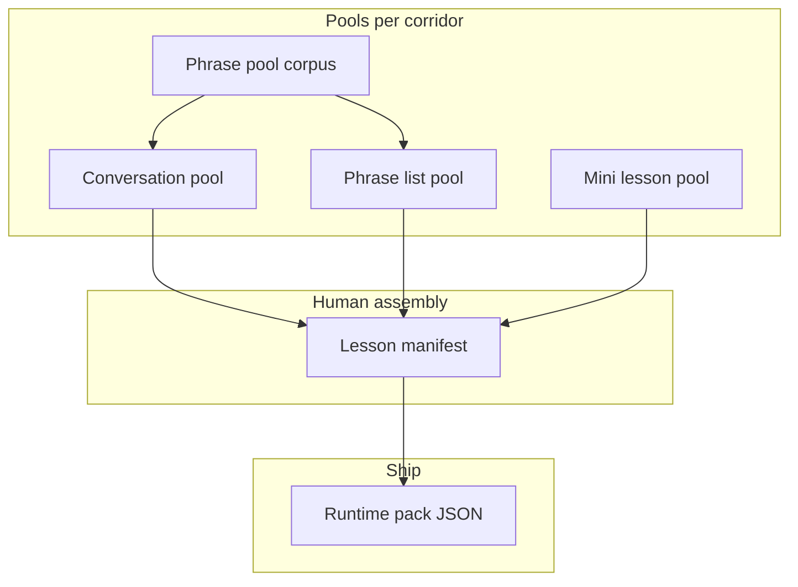

# Content architecture (plan)

LocalReady separates **three reusable pools** from **lessons** that humans assemble. The app still ships one **runtime pack** per corridor (`content/packs/{corridorId}.json`); compilation is the last step.

## Three unit types → three pools

| Unit type | Pool (authoring store) | Role in the player |
|-----------|------------------------|--------------------|
| **Conversation** | `content/conversations/{corridorId}/*.json` | Scene setup → dialogue turns |
| **Phrase list** | `content/phrase-lists/{corridorId}/*.json` | Ordered study/review of lines (not the full corpus) |
| **Mini lesson** | `content/mini-lessons/{corridorId}/*.json` | `description` + **words[]** (target, meaning, optional phraseId) |

**Phrase pool** (corpus, not a lesson unit) stays separate:

| Corpus | Path | Role |
|--------|------|------|
| **Phrase pool** | `content/open/{corridorId}/phrases-pool.json` | Ingest + review (`pending` / `approved` / `rejected`); feeds phrase lists and `phraseId` on turns |

- Conversations **reference** pool items via `phraseId` on turns when possible.
- Phrase lists **pick** pool rows by id (or inline copy for one-offs, then backfill ids).
- Mini lessons **cite** pool rows in `examples[]` or embed `target` + gloss for words that are not full “phrases” yet.



## Lesson = vignettes × references

A **lesson** is one curriculum row (`situation`, order, title, free/paid). It contains **one or more vignettes** (micro-scenes on the same trip beat).

Each **vignette** is an ordered **playlist** of pool items—not a new copy of the dialogue:

```json
{
  "id": "arrival-day",
  "title": { "en": "Arrival day", "id": "Hari kedatangan" },
  "culture": [{ "id": "smile-first", "...": "..." }],
  "sequence": [
    { "kind": "conversation", "ref": "id-id-basics-driver-001" },
    {
      "kind": "miniLesson",
      "ref": "id-id-numbers-pay-001",
      "anchor": { "conversationRef": "id-id-basics-warung-001", "afterTurnId": "id-id-basics-warung-001-t3" }
    },
    { "kind": "conversation", "ref": "id-id-basics-warung-001" },
    { "kind": "phraseList", "ref": "id-id-basics-arrival-drill-001" }
  ]
}
```

**Player order (per vignette):**

1. Optional **culture** cards (still vignette-local or ref culture pool later).
2. Walk `sequence` in order:
   - **conversation** → description → turns (with **mini lesson** steps inserted when `anchor` matches).
   - **mini lesson** (no anchor) → intro step → one step per example.
   - **phrase list** → one step per phrase (flashcard-style or list UI—product choice).

**Lesson 0 (`script`)** can stay a special lesson that uses `scriptBlocks[]` instead of conversations, or become a vignette full of mini lessons—decide when compiling `situation: "script"`.

**Authoring path for lessons (planned):**

```
content/lessons/{corridorId}/{lessonId}.json   # human-built manifest
content/curriculum/spine.json                  # global order, pricing flags
```

Compile: resolve all `ref` ids → merge into `content/packs/{corridorId}.json`.

## Pipelines per pool

### Conversation pool

| Stage | Input | Output | Tooling |
|-------|--------|--------|---------|
| Master (EN) | MultiWOZ-style domains + slots | `content/dialogue-master/en/*.json` | `content:validate:dialogue` |
| Translate | EN master + corridor | `content/dialogue-master/translations/{corridorId}/` | `content:translate-dialogue` (planned) |
| Compile to corridor | Translation + slot fill | `content/conversations/{corridorId}/{id}.json` | `content:compile:dialogue` (planned) |
| Generate | Situation brief + phrase hints | Draft JSON → human edit | CLI / AI offline |
| Manual | JSON, **CSV**, or API | Same store | see [Manual ingest](#manual-ingest) |

Schema today: `StoredConversation` (`situation`, `description`, `turns[]`). Masters use `speaker` + `acts` + slots; compiled conversations use `role` + `line` + optional `phraseId`.

### Phrase pool (corpus)

| Stage | Input | Output | Tooling |
|-------|--------|--------|---------|
| Wikivoyage | Phrasebook wikitext | `pending` rows in `phrases-pool.json` | `npm run content:seed:wv -- {corridor}` |
| AI suggest | Situation + count | `pending` rows | `npm run content:seed:ai` |
| Human review | Dashboard / API | `approved` / `rejected` | `GET/PATCH /api/content/pool` |
| Manual | JSON or **CSV** | `approved` (default) or `pending` | `POST /api/content/inject`, CSV import (planned) |
| Derive | Conversations + approved pool | `content/derived/{corridor}/phrase-catalog.json` | `content:extract:phrases` |

Phrase lists should only reference **approved** ids (compile fails or warns otherwise).

### Mini lesson pool (“words” and micro-topics)

Mini lessons are **pedagogy + examples**, not full dialogues. Good **sources** (often combined):

| Source | Good for | Notes |
|--------|----------|--------|
| **Wikivoyage phrasebook sections** | Numbers, time, money words | Same ingest as phrases; mini lesson groups rows with a `body` |
| **Frequency / travel word lists** | Top 20 verbs, counters, classifiers | e.g. curated CSV per corridor; CC-licensed lists where available |
| **Lesson 0 / script curricula** | Script rows, essential words | Reuse `ScriptBlock`-like rows inside mini lessons or compile script → mini lessons |
| **Conversation gaps** | “You heard X in the scene; here’s the pattern” | Human-authored after dialogue review |
| **AI draft** | First pass on `title` + `body` + examples | Always human review; store `source: "generated"` |
| **Tatoeba / example sentences** | Optional extra examples | Check license; prefer short travel-relevant lines |
| **Official tourism / embassy phrase sheets** | Country-specific etiquette + numbers | Link `sourceUrl`; manual CSV |

Avoid treating OpenSubtitles or large web scrape as default—license and noise are high. Prefer **human-curated CSV** for word lists and WV for phrase-sized lines.

**Mini lesson file (planned shape):**

```json
{
  "schemaVersion": 1,
  "id": "id-id-numbers-pay-001",
  "corridorId": "id-id",
  "topic": "numbers",
  "relatedSituations": ["basics", "money"],
  "description": { "en": "...", "id": "..." },
  "words": [
    { "id": "w-satu", "target": "satu", "meaning": { "en": "one", "id": "satu" }, "phraseId": "..." },
    { "id": "w-lima-ribu", "target": "lima ribu", "meaning": { "en": "five thousand", "id": "..." }, "phraseId": "id-id-basics-lima-ribu" }
  ],
  "source": "manual"
}
```

### Phrase list pool

Curated **ordered** sets for a vignette (drill, “lines you’ll need today”):

```json
{
  "schemaVersion": 1,
  "id": "id-id-basics-arrival-drill-001",
  "corridorId": "id-id",
  "title": { "en": "Lines from arrival day", "id": "..." },
  "phraseIds": [
    "id-id-basics-ada-air-mineral",
    "id-id-basics-lima-ribu"
  ],
  "source": "manual"
}
```

Compile resolves each id from the phrase pool (or catalog) into runtime `Phrase` objects.

## Manual ingest

Today: **JSON API** for phrases only (`POST /api/content/inject`, `GET/PATCH /api/content/pool`). Bearer `CONTENT_INJECT_SECRET`.

**Recommended direction:** one **CSV template per entity**, plus CLI that validates and writes Git-backed files (works in dev; same constraint as API—needs writable `content/`).

| Entity | Suggested CLI | API (optional) |
|--------|----------------|----------------|
| Phrases | `content:import:phrases -- {corridor} file.csv` | extend inject or `POST /api/content/import/phrases` |
| Conversations | `content:import:conversation -- file.csv` (turns as separate CSV or JSON column) | `POST /api/content/import/conversations` |
| Mini lessons | `content:import:mini-lessons -- {corridor} file.csv` | same pattern |
| Phrase lists | `content:import:phrase-lists -- {corridor} file.csv` | same pattern |

**Phrase CSV columns (example):**

`target,romanization,meaning_en,meaning_id,situation_hints,status,notes`

**Mini lesson CSV (two files or one denormalized):**

- `mini-lessons.csv`: `id,topic,title_en,title_id,body_en,body_id`
- `mini-lesson-examples.csv`: `mini_lesson_id,order,target,romanization,meaning_en,meaning_id,phrase_id`

**Conversation CSV:** usually awkward for multi-turn dialogue; prefer **JSON per conversation** or a **turns.csv** keyed by `conversation_id,turn_order,role,target,line_en,line_id,phrase_id`. CSV for metadata + one JSON file per scene is a practical hybrid.

**Lesson manifest:** edit JSON in Git (or a small admin UI later); not ideal as flat CSV because of vignette `sequence` and anchors.

## Human lesson generation workflow

1. **Fill pools** (pipelines above + review).
2. **Draft lesson manifest** — pick conversation ids, mini lesson ids (with anchors), phrase list ids into vignettes.
3. **Compile** — `npm run content:compile:lesson -- {corridor} {situation}` today; evolve to `content:compile:pack` from `content/lessons/`.
4. **QA** — `content:extract:phrases`, spot-check player step count, native speaker pass on `meaning.id`.

No auto lesson assembly in v1: generation = **human curation** from pools. Optional later: AI *suggests* a `sequence` from situation brief; editor accepts in manifest.

## Mapping from today’s repo

| Today | This plan |
|-------|-----------|
| `content/conversations/` | Conversation pool ✓ |
| `content/open/.../phrases-pool.json` | Phrase corpus ✓ |
| `content:build:starter` templates | Replace with lesson manifests + compile |
| `content/packs/*.json` vignettes with embedded conversations | Compiled output; source refs live in `content/lessons/` |
| Culture on vignette | Keep; optional culture pool later |
| `POST /api/content/inject` | Phrases only; extend per table above |

Types to extend when implementing: `lesson-content-types.ts` (mini lesson, phrase list refs), `stored-conversation-types.ts`, new `content/lessons/` + `content/phrase-lists/` + `content/mini-lessons/` schemas, `buildLessonSteps` for `sequence` + anchors.

See also: [PIPELINE.md](./PIPELINE.md), [CONVERSATION.md](./CONVERSATION.md), [README.md](./README.md).
