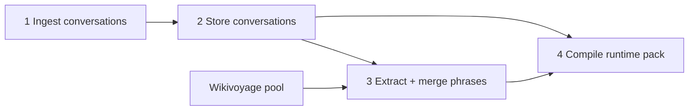

# Content pipeline (conversations first)

LocalReady treats **dialogues as source of truth**. Phrases are **derived** (from turns + Wikivoyage pool). **Lesson 0 (`script`)** teaches the writing system for non-Latin corridors.

## Four steps



### 1) Fetch / scrape / generate conversations

| Method | Output | Notes |
|--------|--------|--------|
| **Generate** | AI draft from situation brief + optional phrase hints | Offline; human review required |
| **Master EN** | `dialogue-master/en/*.json` → translate per corridor | MultiWOZ-style; see CONVERSATION.md |
| **Manual** | JSON in `content/conversations/` | Inject API or Git |
| **Scrape** | Only where license allows; store `sourceUrl` | Not implemented |

Each conversation is a **scene**: `description` + `turns[]` (no quiz in source files).

### 2) Store conversation content

**Canonical store (authoring):**

```
content/conversations/{corridorId}/{conversationId}.json
```

Schema: `StoredConversation` in `src/lib/content/stored-conversation-types.ts`.

**Optional EN masters** (translate into stored conversations):

```
content/dialogue-master/en/{id}.json
content/dialogue-master/translations/{corridorId}/{id}.json
```

**Not** the learner-facing pack — that is compiled in step 4.

### 3) Extract phrases + merge Wikivoyage

```bash
npm run content:extract:phrases -- ja-jp
```

- Reads all `content/conversations/{corridorId}/*.json`
- Collects `target` / `romanization` / gloss from `traveler` + `local` turns
- Merges with **approved** (or all pending) rows from `content/open/{corridorId}/phrases-pool.json`
- Writes `content/derived/{corridorId}/phrase-catalog.json` (deduped by target + meaning)

Use the catalog for cheatsheet, SRS, and QA (“is this line in the pool?”).

Wikivoyage seed (step 0 of pool):

```bash
npm run content:seed:wv -- ja-jp
```

### 4) Compile **runtime pack**

```bash
npm run content:compile:pack -- ja-jp    # planned: manifest + conversations → pack
npm run content:build:starter            # today: pool + templates → pack (dev only)
```

**Shipped file:** `content/packs/{corridorId}.json` — loaded by `loadCorridorPack()`.

Shape: see `CONVERSATION.md` (vignettes → `conversations[]` with `description` + `turns`).

**Curriculum manifest** (planned):

```
content/curriculum/spine.json          # lesson order, free/paid
content/curriculum/{corridorId}.json   # vignetteId → conversationId[], situation, lesson 0 blocks
```

---

## Lesson 0 — `script` (writing system)

For corridors with a non-Latin script (**ja-jp**, **ko-kr**, **th-th**, **vi-vn**):

| Field | Purpose |
|--------|---------|
| `situation: "script"` | Lesson **0** in the app list |
| `scriptBlocks[]` | How letters/syllables work + a few essential words |

**id-id** (Latin): skip or replace with “sounds & spelling” lite — set `scriptLesson: false` in corridor manifest when compiling.

Block types: `src/lib/lesson-content-types.ts` (`ScriptBlock`).

Player: read `scriptBlocks` (not conversation) — UI TBD; pack may ship empty blocks until content exists.

---

## What to run today (dev)

```bash
# Pool (Wikivoyage)
npm run content:seed:wv -- ja-jp

# Conversations: still from starter templates until you add files under content/conversations/
npm run content:build:starter

# After you add conversation JSON files:
npm run content:extract:phrases -- ja-jp
```

---

## Migration from current starter

| Today | Target |
|-------|--------|
| Templates build conversations inside `build-starter-packs` | Ingest → `content/conversations/` → `compile:pack` |
| Phrases only in pool | Pool + **extracted** phrases in `phrase-catalog.json` |
| 8 lessons | **9** with lesson 0 `script` (optional per corridor) |
